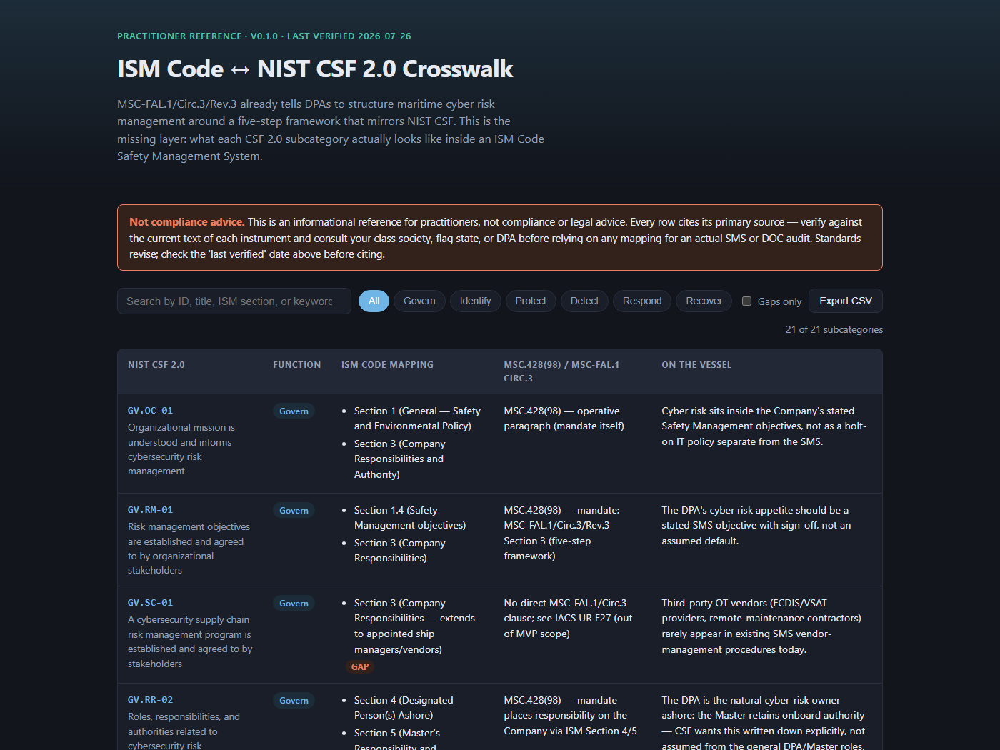

# ISM Code ↔ NIST CSF 2.0 Crosswalk

MSC-FAL.1/Circ.3/Rev.3 already tells DPAs and ship managers to structure maritime cyber risk management around a
five-step framework that mirrors the NIST Cybersecurity Framework. What it doesn't do is say what each control
looks like inside an actual ISM Code Safety Management System. This is a structured, citable crosswalk that closes
that gap — filterable and exportable, instead of another prose PDF.

**Live version:** https://kelvinuduma.github.io/ism-cyber-crosswalk/



## What this is

A row-per-subcategory mapping of NIST CSF 2.0 against:

- The **ISM Code** (IMO Res. A.741(18), as amended) — which SMS section a control belongs in
- **IMO MSC.428(98)** — the 2021 mandate requiring cyber risk in the SMS
- **IMO MSC-FAL.1/Circ.3/Rev.3** (April 2025) — the guidance describing how
- **BIMCO's Guidelines on Cyber Security Onboard Ships** (5th Ed, Nov 2024) — industry guidance from BIMCO, ICS, INTERCARGO, INTERTANKO, OCIMF et al.

Each row also carries a plain-English "what this looks like on the vessel" note, and rows with no strong ISM
equivalent are flagged as a **gap**, not smoothed over.

## What this is not

**Not compliance or legal advice.** This is a practitioner reference for DPAs, ISM/ISPS compliance officers, and
maritime cyber consultants — not a substitute for your class society, flag state, or legal counsel. Every mapping
is an interpretation cross-referencing the cited primary sources; verify against current text before relying on
any row for an actual SMS document, DOC audit, or class review. Standards revise — check the "last verified" date
in the app before citing.

## Scope (v0.2)

21 NIST CSF 2.0 subcategories across all six functions (Govern, Identify, Protect, Detect, Respond, Recover),
mapped against ISM Code sections, the two governing IMO instruments, and BIMCO's _Guidelines on Cyber Security
Onboard Ships_ (5th Ed, Nov 2024). IACS UR E26/E27 and OCIMF TMSA3/SIRE 2.0 are deliberately out of scope for
now — see [Roadmap](#roadmap).

The BIMCO mappings cite guidance by section name (e.g. "Identify vulnerabilities", "Assess risk exposure")
rather than clause numbers, pending a verification pass against the current PDF — check the "last verified"
date before citing a BIMCO row.

## Running locally

No build step. Use the bundled scripts for a consistent local workflow:

```bash
npm run validate
npm run serve
# then open http://localhost:8000
```

You can also use a plain static server if preferred:

```bash
python -m http.server 8080
# then open http://localhost:8080
```

## Data validation and schema

The project includes a lightweight validation script and a machine-readable schema to catch bad JSON and structural drift before publication:

```bash
npm run validate
```

Schema file: [`crosswalk.schema.json`](crosswalk.schema.json)

This checks:
- valid JSON syntax
- unique subcategory IDs
- valid CSF functions
- valid framework keys in each row
- required mapping object structure
- boolean `gap` field values
- row-level `sourceTrace` metadata

## Contributing updates

Contributions are welcome via issue or PR. For a dataset change, please:

1. Cite the relevant source text or clause.
2. Explain the interpretation in plain language.
3. Update the row's relationship/gap status only if the evidence supports it.
4. Validate before opening the PR:

```bash
npm run validate
```

If you are changing a mapping or adding a new subcategory, include the source reference, the rationale, and a brief note on any practical vessel example.

## Contributor checklist

Before submitting a PR, confirm all of the following:

- the row includes a valid `id`, `function`, `title`, and `mappings` object
- each mapping references the exact source clause or guidance title
- the `gap` field matches the evidence; do not convert a gap into a support case without a direct mapping
- the practical vessel example is plain English and consistent with the source text
- the data still passes:

```bash
npm run validate
```

## Data

The full dataset lives in [`data/crosswalk.json`](data/crosswalk.json) — one object per subcategory, with the ISM
mapping, the relevant MSC.428(98)/MSC-FAL.1 clause, a vessel-context note, and a `gap` flag.

## Roadmap

- [x] BIMCO Guidelines 5th Ed as an additional target framework
- [ ] IACS UR E26 / UR E27 (newbuild-specific requirements)
- [ ] OCIMF TMSA3 / SIRE 2.0
- [ ] Self-assessment / gap-scoring mode

## License

MIT.
